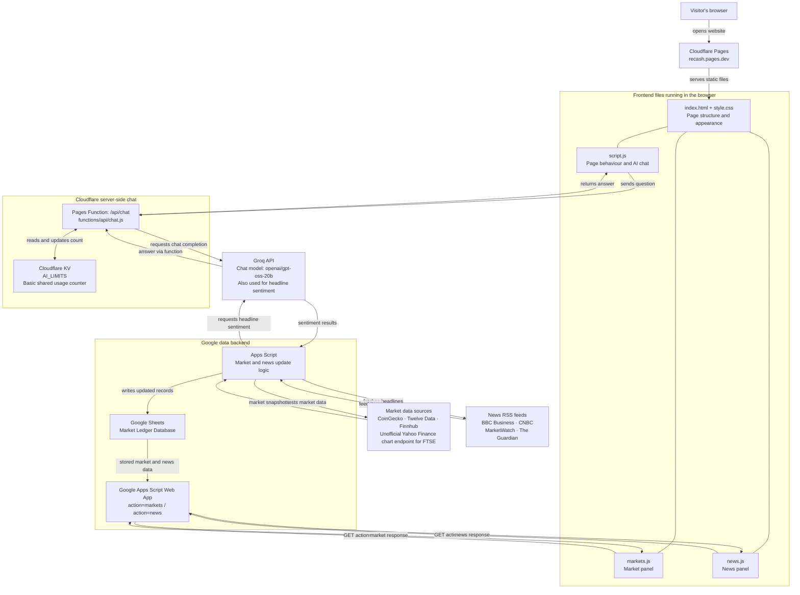
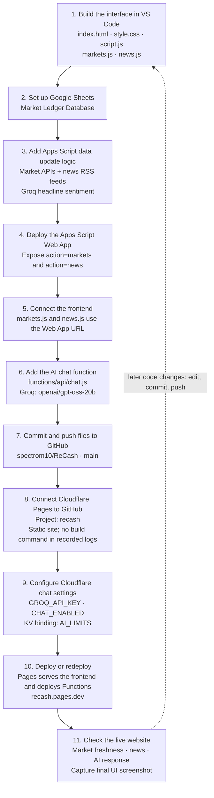

# ReCash

**A clearer view of the markets.** A prototype dashboard combining market snapshots, financial headlines, AI headline sentiment, and an educational AI chat.

[Open ReCash](https://recash.pages.dev) · [GitHub repository](https://github.com/spectrom10/ReCash)

## Final interface

*Original final UI screenshot supplied on 29 October 2026, copied without modification. The screenshot shows a point in time, including a preview ticker and some stale market prices.*

## How everything connects

The browser loads the website from Cloudflare Pages. Market and news panels request data from a Google Apps Script Web App, backed by the **Market Ledger Database** in Google Sheets. AI chat takes a separate route through a Cloudflare Pages Function.

Arrows below label requests, data reads/writes, or responses; they do not imply that every source is contacted whenever someone opens the page.

- **Frontend:** HTML creates the page, CSS styles it, and JavaScript fills the panels and handles interaction.
- **Data backend:** Apps Script collects source data, uses Groq for headline sentiment, and stores results in Sheets. Its Web App exposes the market and news data to the frontend.
- **AI chat backend:** `functions/api/chat.js` handles browser questions, uses the `AI_LIMITS` KV binding for the basic usage limit, and calls Groq. The browser should not contain the Groq API key.
- **Model name:** `openai/gpt-oss-20b` is accessed through Groq. It does not imply a separate OpenAI API connection. The headline-sentiment model is not specified here.

## Build and deployment workflow

This is a practical reconstruction of the build workflow from the conversation and supplied project details, rather than an exact commit-by-commit history. It includes the connections needed to understand and maintain the site.

### What to keep connected

| Connection | Purpose |
| --- | --- |
| VS Code → GitHub `spectrom10/ReCash` | Save and version website source files. |
| GitHub `main` → Cloudflare Pages `recash` | Deploy committed website changes. |
| `markets.js` → Apps Script `action=markets` | Load the market panel. |
| `news.js` → Apps Script `action=news` | Load financial headlines and available sentiment. |
| Apps Script ↔ Google Sheets | Maintain and serve the Market Ledger Database. |
| Apps Script → market APIs and RSS feeds | Collect market data and headlines. |
| Apps Script → Groq | Analyse headline sentiment. |
| `script.js` → `/api/chat` → Groq | Send questions and display AI answers. |
| `/api/chat` ↔ Cloudflare KV `AI_LIMITS` | Track basic shared chat usage. |

Keep API credentials in the relevant server-side configuration, rather than in public frontend files or this README. After changing Cloudflare settings, redeploy as needed and check the live chat.

## Limits and prototype behaviour

- **Basic shared AI limit:** The conversation requested 20 ReCash AI questions per day across the site. The KV counter is basic protection: KV updates are not an atomic counter, and concurrent requests can exceed the intended limit. Do not describe it as a guaranteed strict cap. The exact reset boundary and counting behaviour depend on the deployed function. This chat limit does not establish a limit on separate Apps Script sentiment calls.
- **Market freshness:** Stored values can be delayed, stale, or unavailable because of refresh timing, provider limits, or source failures. A successful page load does not prove that prices are current. The final screenshot explicitly shows stale prices and a forex availability notice. No refresh interval or installed Apps Script trigger schedule is confirmed here.
- **Demo ticker:** The top forex strip says “Preview · Live prices not connected.” It is a placeholder and should not be presented as a live quote feed, even when the market panel contains stored currency values.
- **FTSE source:** The Yahoo Finance chart endpoint is unofficial; availability and behaviour can change.
- **AI output:** Chat is for financial education, and headline sentiment is informational. Neither establishes a live trading signal or an automated trade-execution connection.

## Free platforms, tools, and sources used

Recorded as free tools or free-access services in this project; provider quotas, account terms, and future pricing still apply. RSS publishers and data providers are included as sources.

- Visual Studio Code
- GitHub
- Cloudflare Pages
- Cloudflare Pages Functions
- Cloudflare KV
- Groq
- Google Sheets
- Google Apps Script
- CoinGecko
- Twelve Data
- Finnhub
- Yahoo Finance (unofficial chart endpoint)
- BBC Business RSS
- CNBC RSS
- MarketWatch RSS
- The Guardian RSS

## Using this README

Copy `README.md` and the `assets` folder together into the root of the ReCash repository. Keep `assets/recash-final-ui.png` at that relative path so the screenshot displays on GitHub. GitHub renders the Mermaid diagrams directly; no extra diagram service is part of the website.

---

*Documentation snapshot: 29 October 2026. Based on the supplied ReCash project details, the accessible conversation history, and the original UI screenshot. This describes the recorded architecture, not a fresh audit of the deployed repository or service configuration. Exact provider-to-instrument mappings and refresh schedules are intentionally left unspecified where unconfirmed.*
